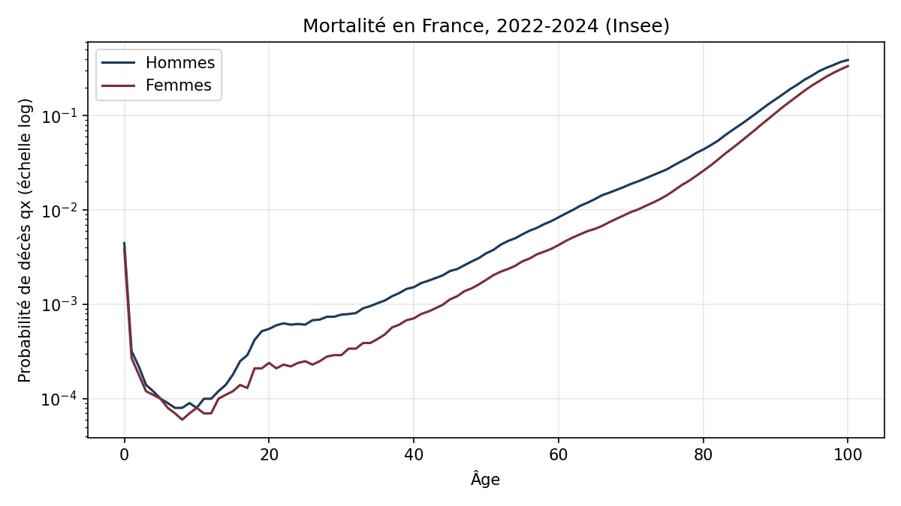
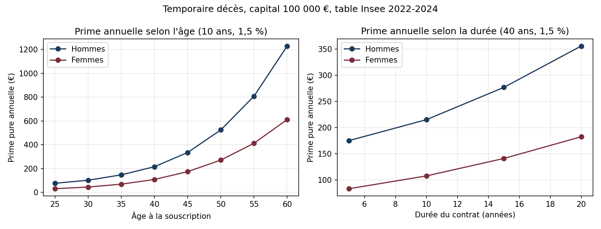

# Tarification d'une assurance temporaire décès

Calcul de la prime d'une assurance temporaire décès à partir de la table de mortalité de l'Insee (2022-2024), en Python, avec analyses de sensibilité et passage à la prime commerciale.

**Résultat principal.** Pour un homme de 40 ans, un capital de 100 000 € sur 10 ans et un taux technique de 1,5 %, la prime pure annuelle est de **215,21 €**. Pour une femme du même âge, elle est de **107,82 €** (−50 %).

---

## 1. Objectif

Une assurance temporaire décès verse un capital aux bénéficiaires si l'assuré décède avant la fin du contrat. Si l'assuré est en vie au terme, le contrat s'arrête sans versement.

Le projet répond à trois questions :

1. Quelle est la prime pure (unique et annuelle) de ce contrat ?
2. Comment varie-t-elle selon le sexe, l'âge, la durée et le taux technique ?
3. Quel est l'écart entre la prime pure et la prime commerciale payée par le client ?

## 2. Données

| | |
|---|---|
| Source | [Insee, Table de mortalité en données triennales, France (DEC6)](https://www.insee.fr/fr/statistiques/8560675?sommaire=8560708) |
| Période | 2022 à 2024 (résultat provisoire), onglet « 2024 » |
| Contenu | Survivants (lx), quotients de mortalité (qx) et espérance de vie, par sexe, de 0 à 104 ans |

Contrôle de cohérence : le qx recalculé à partir des survivants (dx / lx) ne s'écarte du qx publié que de 0,0003 au maximum, écart dû à l'arrondi des lx.

**Choix de la table.** En pratique, les assureurs français tarifient le risque décès avec les tables réglementaires TH00-02 / TF00-02 ou avec une table d'expérience certifiée. La table Insee est utilisée ici parce qu'elle est publique et récente.



En échelle logarithmique, la mortalité suit presque une droite après 30 ans (loi de Gompertz) : le risque de décès double environ tous les 8 à 10 ans d'âge.

## 3. Méthode

Hypothèses : capital payé en fin d'année de décès, primes annuelles payées en début d'année tant que l'assuré est en vie, facteur d'actualisation v = 1 / (1 + i).

**Valeur actuelle du capital décès (prime pure unique pour 1 €)**

$$A^1_{x:\overline{n}|} = \sum_{k=0}^{n-1} {}_kp_x \; q_{x+k} \; v^{k+1}$$

**Valeur actuelle d'une prime annuelle de 1 €**

$$\ddot{a}_{x:\overline{n}|} = \sum_{k=0}^{n-1} {}_kp_x \; v^{k}$$

**Prime pure annuelle (principe d'équivalence)**

$$P = C \times \frac{A^1_{x:\overline{n}|}}{\ddot{a}_{x:\overline{n}|}}$$

Le calcul est vérifié par une seconde méthode, les nombres de commutation (Dx, Nx, Cx, Mx) : les deux méthodes donnent le même résultat à la sixième décimale.

## 4. Résultats

### Contrat de référence : 40 ans, 10 ans, 100 000 €, taux technique 1,5 %

| | Hommes | Femmes |
|---|---|---|
| Prime pure unique | 1 997,91 € | 1 005,25 € |
| Prime pure annuelle | 215,21 € | 107,82 € |

### Sensibilité à l'âge et à la durée



| Âge à la souscription | 25 | 30 | 35 | 40 | 45 | 50 | 55 | 60 |
|---|---|---|---|---|---|---|---|---|
| Prime annuelle hommes (€) | 76 | 101 | 147 | 215 | 335 | 525 | 808 | 1 230 |
| Prime annuelle femmes (€) | 30 | 44 | 68 | 108 | 174 | 271 | 412 | 612 |

- La prime est multipliée par environ 1,5 tous les 5 ans d'âge.
- Un contrat plus long coûte plus cher par an (175 € sur 5 ans, 356 € sur 20 ans pour un homme de 40 ans), car il couvre des années à âge plus élevé. La prime nivelée dépasse le risque annuel en début de contrat et lui est inférieure en fin de contrat : cet écart constitue la provision mathématique.

### Sensibilité au taux technique (homme, 40 ans, 10 ans)

| Taux technique | 0 % | 1 % | 1,5 % | 2,5 % | 3,5 % |
|---|---|---|---|---|---|
| Prime annuelle (€) | 220,52 | 216,96 | 215,21 | 211,78 | 208,44 |
| Variation | +2,5 % | +0,8 % | réf. | −1,6 % | −3,1 % |

Le taux technique a peu d'effet sur une temporaire décès à prime annuelle : l'actualisation réduit à la fois la valeur des sinistres et celle des primes futures, et les deux effets se compensent en grande partie. Sur un contrat d'épargne ou de rente, le taux technique serait au contraire déterminant.

### Tarification unisexe

Depuis 2012, la tarification ne peut plus dépendre du sexe. Avec une hypothèse prudente (table des hommes pour tous), une femme de 40 ans paierait 215,21 € au lieu de 107,82 €, soit 107 € de plus par an : l'écart de mortalité est mutualisé entre assurés hommes et femmes.

### De la prime pure à la prime commerciale

Hypothèses illustratives : 20 € par an de frais de gestion et un chargement de 15 % de la prime commerciale (acquisition et encaissement).

| | Homme, 40 ans |
|---|---|
| Prime pure annuelle | 215,21 € |
| Prime commerciale | 276,72 € |
| Part du risque dans le prix | 78 % |

## 5. Limites et pistes

- Table de population générale : la mortalité des assurés est en général plus faible (sélection médicale à la souscription). Une table d'expérience ou un abattement serait plus réaliste.
- Table du moment : elle n'intègre pas la baisse future de la mortalité.
- Âges élevés : chez les hommes, le quotient de mortalité baisse entre 103 et 104 ans, à cause des faibles effectifs. Un lissage de la fin de table serait nécessaire pour des âges élevés (sans effet sur les contrats étudiés ici).
- Les chargements sont illustratifs et ne correspondent pas au tarif d'un assureur.

## 6. Reproduire les calculs

```
pip install pandas matplotlib openpyxl
python etape2_table_mortalite.py
python etape_3_tarification.py
python etape4_sensibilites.py
```

| Fichier | Rôle |
|---|---|
| `etape2_table_mortalite.py` | Lecture, nettoyage et contrôle de la table Insee, courbe de mortalité |
| `etape_3_tarification.py` | Prime pure unique et annuelle, contrôle par les nombres de commutation |
| `etape4_sensibilites.py` | Sensibilités (sexe, âge, durée, taux), tarif unisexe, prime commerciale |
| `data/` | Table Insee d'origine et table nettoyée (CSV) |
| `resultats/`, `graphiques/` | Tableaux et graphiques produits par les scripts |

---

Vanessa Mancini · Master 1 Actuariat, Le Cnam · [LinkedIn](https://www.linkedin.com/in/vanessa-mancini-47b90122)
